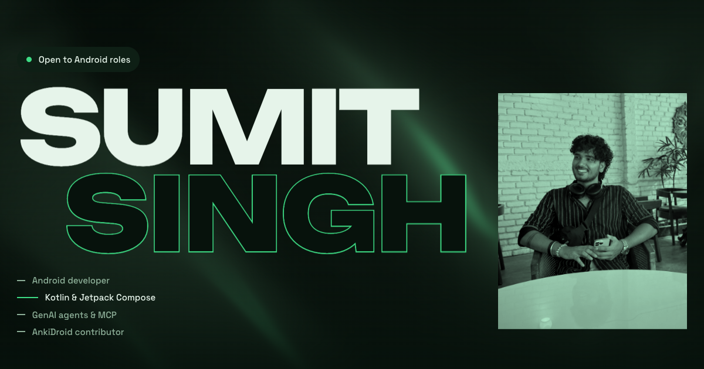

# Sumit Singh · Portfolio

Personal portfolio of **Sumit Singh (giyutomiokaSS)**, software engineer at Tata 1MG building Android apps with Kotlin and Jetpack Compose.

**Live:** [hiisumit.com](https://hiisumit.com)



## What's inside

- **Hero:** WebGL silk background, a big name intro and rotating roles
- **Experience:** Tata 1MG, AnkiDroid, OTPLESS, VITTO and MOLOG, each with its headline result
- **Projects:** ResQSync, Neer and NewsHub, each shown as two app screens built in HTML/CSS. The Neer screen is interactive.
- **Skills:** an orbit of tools plus skill trees with animated pulses
- **Contact:** particle "Let's talk", a scrolling marquee and copy-to-clipboard links
- **Light and dark themes:** an animated switch that remembers your choice

## Tech

Plain HTML, CSS and JavaScript, with no build step.

- [GSAP](https://gsap.com/) with ScrollTrigger and SplitText
- [Lenis](https://lenis.darkroom.engineering/) for smooth scrolling
- Fonts: Unbounded, Space Grotesk and JetBrains Mono (Google Fonts)
- Hosted on GitHub Pages with a custom domain (`CNAME`)

## Run locally

```bash
git clone https://github.com/Giyutomioka-SS/giyutomiokaSS-portfolio.git
cd giyutomiokaSS-portfolio
python3 -m http.server 8080
# open http://localhost:8080
```

## Structure

```
index.html   page markup and SEO meta
style.css    design tokens and styles (both themes)
app.js       animations and interactions
assets/      photo, avatar, app icons, skill icons, social preview
DESIGN.md    design system notes
```

## License

See [LICENSE](LICENSE).
